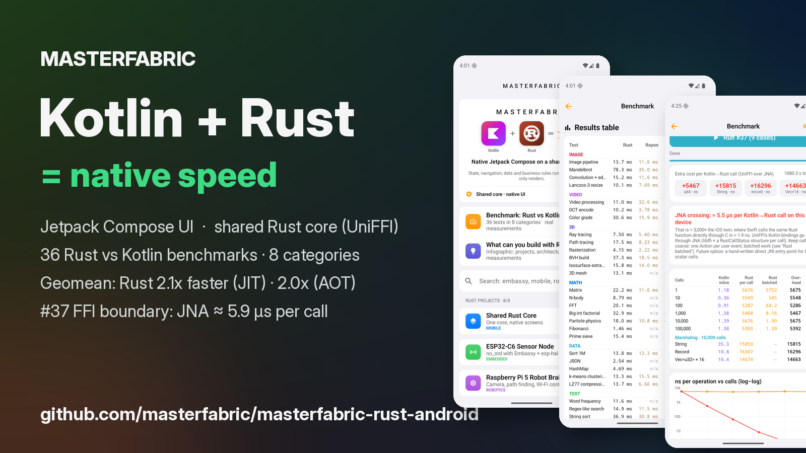
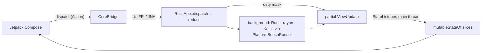
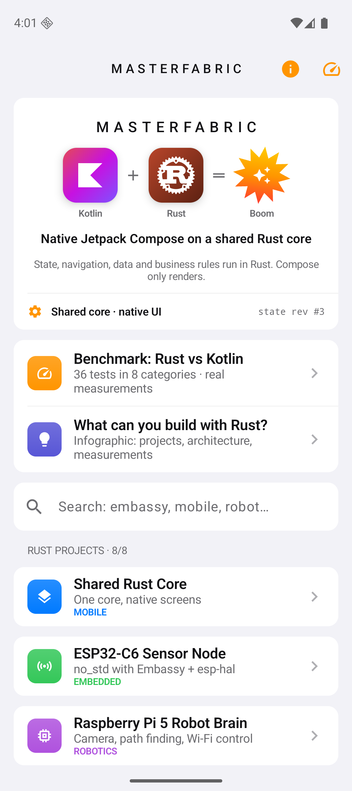
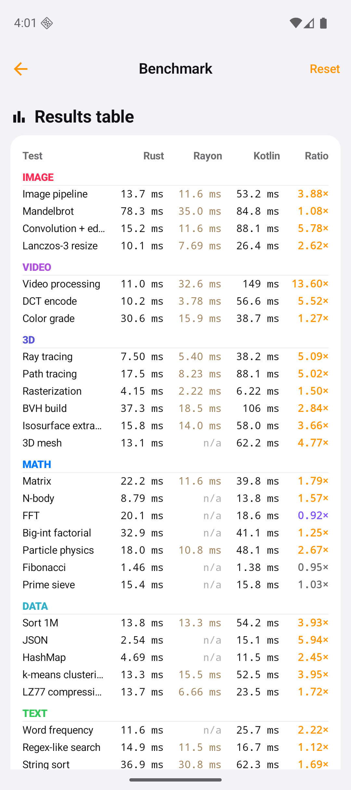
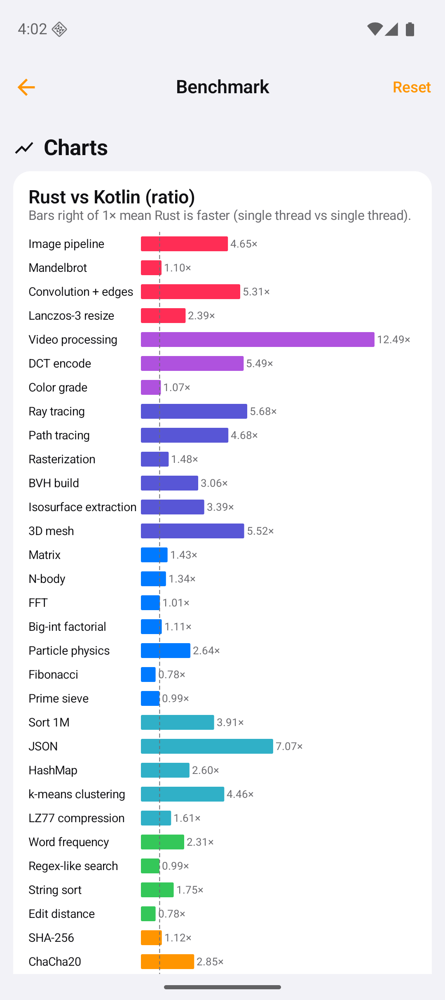
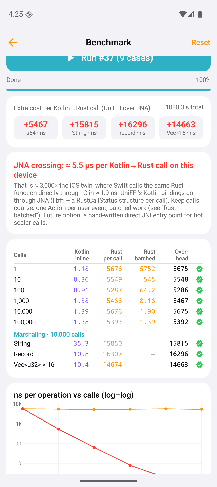

<p align="center"></p>

# MasterFabric · Kotlin + Rust (Android)

Native **Jetpack Compose / Material 3** on the same Rust core as the
[iOS twin](https://github.com/masterfabric/masterfabric-rust-ios). State, navigation,
data, business rules and benchmark orchestration live in Rust; Compose renders and
forwards actions. UniFFI **library-mode Kotlin bindings over JNA** connect the two.

## Flow



Only dirty slices (NAV, HOME, DETAILS, BENCH, INFO, PERF) cross back; no-op actions
emit nothing. The navigation stack belongs to Rust; the system Back button sends
`Action.Back`. Benchmarks run on Rust's `mf-benchmark` thread, never the UI thread.

## Layout

| Path | What |
|---|---|
| `crates/app-core` | reducer, store, navigation, screen view models; 36 kernels in `workloads.rs`, `media.rs`, `heavy.rs`; #37 in `ffi_bench.rs` |
| `crates/app-ffi` | UniFFI API: `AppCore`, `StateListener`, `PlatformBenchRunner`, tiny `ffi_*` functions |
| `crates/uniffi-bindgen` | library-mode bindgen executable |
| `platforms/android` | Gradle Kotlin DSL, wrapper 8.14.3, application `co.masterfabric.rust` |
| `…/java/co/masterfabric/rust/bridge` | slice-based CoreBridge, device information, perf export |
| `…/ui`, `…/brand` | four native screens, Compose Canvas charts, wordmark and Kotlin + Rust hero |
| `…/bench` | all 36 Kotlin workload ports + #37 inline/per-call/batched loops |
| `scripts` | cargo-ndk build/bindgen, emulator launcher, measurement and summaries |
| `docs/results` | raw device JSON and summary tables (reproducible measurements, not invented data) |

Generated UniFFI Kotlin, `jniLibs`, APKs, Gradle caches and `local.properties` are ignored.
`arm64-v8a` and `x86_64` are built; minimum Android is API 26, compile/target API 36.

## Screens

- **Home**: MASTERFABRIC wordmark, Kotlin + Rust hero, live Rust revision, searchable project list.
- **Detail**: item, favorite toggle, related projects. State is in Rust.
- **Benchmark**: 36 tests, eight category buttons, ratio table, grouped duration/ratio charts,
  ray-trace output from both languages, app-perf card and separate **#37 FFI boundary** section.
- **Info**: Rust project ideas, architecture diagram, only this app's measured ratios,
  strengths, trade-offs and app performance.

<p>   </p>

## Benchmarks

36 tests, identical algorithms, input generators (XorShift32) and checksums. ✓ = Rust rayon variant.

| Category | Tests (size) |
|---|---|
| Image | image pipeline: blur → bilinear 512² → LUT → YUV (1024²) ✓ · Mandelbrot, 256 iterations (768²) ✓ · 5×5 gaussian + 3×3 Sobel (1536²) ✓ · Lanczos-3 resize (1024² → 768²) ✓ |
| Video | YUV + blur + frame diff + motion estimation (30 × 640×360) ✓ · 8×8 DCT-II + JPEG quantization (16 frames) ✓ · color grade: gamma LUT, saturation, vignette, histogram (8 × 720p) ✓ |
| 3D | ray tracing (256², 4 spp) ✓ · path tracing, 8 spp, 4 bounces (160²) ✓ · z-buffer rasterization (3,000 tris) ✓ · BVH build, median split (50,000 tris) ✓ · isosurface via surface nets over 3 metaballs (128³) ✓ · icosphere mesh + OBJ export (20,480 tris) |
| Math | matrix multiply (512²) ✓ · 5-body N-body (300,000 steps) · radix-2 FFT (2¹⁸) · big-int factorial (10,000!) · particle physics (200,000 × 50 steps) ✓ · Fibonacci (30) · prime sieve (5,000,000) |
| Data | sort (1,000,000 u32) ✓ · JSON encode + decode (serde_json vs Android org.json, 5,000 records) · HashMap counting (300,000) · k-means, k = 16 (200,000 points) ✓ · LZ77 compression (1 MiB) ✓ |
| Text | word frequency (2 MiB) · regex-like search, 5 patterns (1 MiB) ✓ · string sort (200,000) ✓ · Levenshtein (8 pairs × 1,600 chars) ✓ |
| Crypto | SHA-256, hand-written, no CryptoKit (4 MiB) · ChaCha20, RFC 8439 (4 MiB) ✓ · CRC-32 table-driven (8 MiB) |
| Algorithms | Dijkstra, binary heap (512² grid) · BFS, CSR (300k nodes, 1.2M edges) · N-Queens (13) ✓ · Sudoku backtracking (160 puzzles) ✓ |

Each test runs one warm-up then N timed samples (the parameter and run count are shown
in the UI). Ratio = **Kotlin average / single-thread Rust average**; >1 favors Rust.
Rayon results are separate, never mixed into that ratio. No Kotlin parallel variants.
Floating-point contributions are quantized before summing so parallel ordering is irrelevant.

### What the 36 timings include (and exclude)

Rust uses `Instant` around its kernel; Kotlin uses `System.nanoTime` inside the
`PlatformBenchRunner.run` callback. **The crossing is outside both timers.** Inputs are
generated in each kernel, not marshaled per item. The ratios compare compute, not the
cost of moving every operation across JNA. App dispatch→apply includes the crossing;
test #37 measures tiny chatty calls explicitly.

The JSON test is a standard-library comparison (`serde_json` vs Android `org.json`),
not a pure language comparison. Allocation and input generation are included. Generic
ABI code generation is used, not `target-cpu=native` or an Apple-only target tuning.

### Android results

Pixel 9 AVD `sdk_gphone64_arm64`, Android 16 / API 36, 4 vCPU emulator on an M4 Pro Mac; benchmark build; median of 3 app launches. **All 36 checksums matched in every run (JIT and AOT).**

| Mode | Geomean Kotlin / Rust | Range |
|---|---:|---|
| ART default (JIT, warm-up included per test) | **2.12×** | per-run 2.10–2.14× |
| AOT (`cmd package compile -m speed -f`) | **2.04×** | per-run 1.97–2.05× |

| Test | Category | Rust ms | Rust ∥ ms | Kotlin JIT ms | Ratio JIT | Kotlin AOT ms | Ratio AOT |
|---|---|---:|---:|---:|---:|---:|---:|
| image | Image | 8.87 | 5.55 | 45.75 | 5.16× | 28.87 | 3.81× |
| mandelbrot | Image | 65.09 | 20.47 | 73.67 | 1.13× | 73.76 | 1.12× |
| convolve | Image | 15.13 | 9.37 | 74.24 | 4.91× | 39.30 | 2.72× |
| lanczos | Image | 10.12 | 6.68 | 22.21 | 2.20× | 18.89 | 1.98× |
| video | Video | 10.34 | 19.63 | 121.31 | 11.73× | 118.75 | 11.78× |
| dct | Video | 9.87 | 3.70 | 48.89 | 4.95× | 46.04 | 4.94× |
| grade | Video | 28.24 | 10.27 | 28.52 | 1.01× | 27.17 | 0.94× |
| raytrace | 3D | 6.16 | 3.65 | 36.68 | 5.95× | 30.28 | 5.21× |
| pathtrace | 3D | 16.77 | 5.73 | 70.93 | 4.23× | 66.94 | 4.10× |
| raster | 3D | 3.88 | 2.60 | 6.00 | 1.55× | 6.43 | 1.64× |
| bvh | 3D | 31.60 | 14.99 | 95.64 | 3.03× | 91.35 | 2.99× |
| isosurface | 3D | 15.71 | 10.99 | 54.74 | 3.48× | 50.18 | 3.32× |
| mesh | 3D | 10.75 | — | 53.20 | 4.95× | 46.25 | 4.46× |
| matmul | Math | 22.37 | 9.31 | 30.61 | 1.37× | 28.76 | 1.38× |
| nbody | Math | 7.21 | — | 11.80 | 1.64× | 11.66 | 1.67× |
| fft | Math | 10.26 | — | 13.71 | 1.34× | 15.09 | 1.57× |
| bigint | Math | 29.04 | — | 34.10 | 1.17× | 33.46 | 1.18× |
| particles | Math | 17.10 | 7.50 | 43.75 | 2.56× | 44.79 | 2.69× |
| fib | Math | 1.45 | — | 1.38 | 0.95× | 1.34 | 0.97× |
| sieve | Math | 12.26 | — | 13.27 | 1.08× | 13.54 | 0.97× |
| sort | Data | 12.46 | 9.69 | 45.65 | 3.66× | 43.99 | 3.71× |
| json | Data | 2.14 | — | 13.29 | 6.21× | 11.48 | 5.50× |
| hashmap | Data | 4.54 | — | 9.53 | 2.10× | 7.81 | 1.81× |
| kmeans | Data | 11.44 | 8.69 | 45.28 | 3.96× | 43.16 | 3.84× |
| lz77 | Data | 13.84 | 6.17 | 19.71 | 1.42× | 17.58 | 1.30× |
| wordfreq | Text | 10.65 | — | 23.25 | 2.18× | 23.35 | 2.30× |
| textsearch | Text | 12.67 | 5.96 | 15.69 | 1.24× | 15.35 | 1.22× |
| strsort | Text | 29.93 | 21.65 | 55.16 | 1.84× | 51.56 | 2.03× |
| levenshtein | Text | 17.46 | 6.49 | 13.28 | 0.76× | 13.62 | 0.82× |
| sha256 | Crypto | 13.43 | — | 15.21 | 1.13× | 15.27 | 1.20× |
| chacha20 | Crypto | 5.79 | 4.19 | 16.52 | 2.86× | 16.27 | 2.95× |
| crc32 | Crypto | 30.62 | — | 32.50 | 1.06× | 31.93 | 1.07× |
| dijkstra | Algorithms | 15.94 | — | 15.43 | 0.97× | 15.39 | 0.96× |
| bfs | Algorithms | 22.63 | — | 28.35 | 1.25× | 24.48 | 1.15× |
| nqueens | Algorithms | 21.79 | 7.58 | 23.27 | 1.07× | 22.86 | 1.06× |
| sudoku | Algorithms | 12.62 | 5.17 | 21.63 | 1.71× | 21.13 | 1.70× |

Largest Rust leads (JIT): video 11.7×, json 6.2×, raytrace 6.0×, image 5.2×, dct 5.0×. Kotlin is at parity or faster on grade 1.01×, dijkstra 0.97×, fib 0.95×, levenshtein 0.76×; these are simple integer loops that ART compiles well.

App: launch→first frame 102 ms, Rust core init 50.9 ms, dispatch→state applied avg 172 µs (p95 454 µs), full snapshot 220 µs, dispatch→next frame avg 4.8 ms. Raw JSON: `docs/results/`.

### #37 · FFI boundary / chatty calls

For N = 1, 10, 100, 1k, 10k, 100k, run the same multiply/xor/rotate `mix` in three ways:

| Variant | Boundary |
|---|---|
| Kotlin inline | none; pure Kotlin loop |
| Rust per call | one UniFFI `ffiMix` call per operation |
| Rust batched | one `ffiMixBatch` call for all N operations |

Plus String (~20 ASCII bytes), record (3 × i32), Vec (16 × u32) cases, each 10k calls.
Every sample performs about one million operations (reps × N), with per-rep seeds to
prevent hoisting; one warm-up + five timed samples, median ns/op. Timing is on the
Kotlin caller side; case order, reference checksums, verdicts and break-even analysis
are owned by Rust. All variants must match Rust's reference.

Results (same emulator, benchmark build, ART default mode, median of 3 app launches; **every checksum matched**):

run 2 ok
run 3 ok
3 runs · median ns per operation
| Case | Calls | Kotlin inline | Rust per call | Rust batched | Overhead / call | Checksums |
|---|---:|---:|---:|---:|---:|:---:|
| u64 | 1 | 1.20 | 5516.33 | 5577.25 | 5515.13 | ✅ |
| u64 | 10 | 0.35 | 5991.50 | 600.88 | 5991.15 | ✅ |
| u64 | 100 | 0.96 | 5960.75 | 58.67 | 5959.79 | ✅ |
| u64 | 1,000 | 1.30 | 5994.62 | 7.22 | 5993.26 | ✅ |
| u64 | 10,000 | 1.31 | 5685.61 | 1.95 | 5684.30 | ✅ |
| u64 | 100,000 | 1.37 | 5990.26 | 1.43 | 5988.89 | ✅ |
| string | 10,000 | 35.05 | 16415.87 | — | 16380.82 | ✅ |
| record | 10,000 | 10.19 | 14846.04 | — | 14834.27 | ✅ |
| vec16 | 10,000 | 9.42 | 15263.47 | — | 15254.74 | ✅ |

Scalar crossing estimate (median of runs): 5920.53 ns

ns per operation. **The headline: one scalar Kotlin→Rust UniFFI call costs ≈ 5.9 µs here, versus ≈ 1.9 ns
on the iOS twin (≈ 3,000×).** Takeaways:
- **Per-call JNA is the cost, not Rust.** A u64→u64 call adds ≈ 5.5–6.0 µs while the op itself is ≈ 1.3 ns.
  A String/record/Vec argument raises that to ≈ 15–16 µs per call.
- **Batching removes it**: one `ffiMixBatch` call reaches ≈ 1.4 ns/op at 100k ops, i.e. inline Kotlin speed.
  At N = 1 the batched call pays the same ≈ 5.6 µs crossing.
- **Break-even**: with the measured ≈ 2.1× compute advantage, a Kotlin→Rust call must carry ≈ 11 µs of
  Kotlin-time work (scalar args) or ≈ 30 µs (Vec/record) before moving it to Rust pays off. This app sends
  one `Action` per user event and one partial `ViewUpdate` back; the 36 tests cross once per test.
- Emulator caveat: JNA/libffi cost on a physical arm64 phone will differ; re-measure on hardware.
- **Future work**: for hot scalar paths, a hand-written direct JNI entry point (`external fun` +
  `#[no_mangle] extern "system"` in Rust, no Structure/libffi per call) or a coarser batched API would
  avoid most of this; UniFFI/JNA remains the default for its safety and generated types.

<p></p>

**Android is not a direct Swift/C call.** UniFFI's Kotlin binding uses JNA direct mapping,
libffi and a new `UniffiRustCallStatus` structure per call. String/record/Vec add
RustBuffer serialization and allocations. Do not apply the iOS twin's nanosecond
crossing numbers to Android. Batch work and send coarse-grained Actions/ViewUpdates.
For a measured compute speedup S > 1 and crossing overhead C, break-even Kotlin work
per call is C / (1 − 1/S). This is a model, not a universal threshold.

## Performance and correctness notes

- Rust release: `opt-level=3`, fat LTO, one codegen unit, stripped. `panic=abort` makes
  a Rust panic terminate the app (not a recoverable UniFFI error).
- Benchmark build: non-debuggable, R8/shrink release-like, debug-signed for local install.
  `assembleDebug` is for development, not the measurements below.
- **Emulator = M4 Pro Mac CPU, not Pixel hardware.** Results include host scheduling,
  virtualization and software graphics; run a physical arm64 device before making product decisions.
- **ART JIT vs AOT**: the recorded default/JIT runs warm each kernel, but callbacks,
  class loading and tiering remain. `adb shell cmd package compile -m speed -f co.masterfabric.rust`
  provides a separate AOT comparison. Do not silently mix AOT and JIT samples.
- DCT cosine table uses `black_box(angle).cos()` in Rust so LLVM cannot precompute
  the values using the macOS build-host libm while Kotlin uses Android libm. That
  cross-compilation difference caused 1-ulp rounding/checksum drift; runtime table
  generation makes the Android implementations agree without weakening the checksum.
- App timing: launch→first frame is Activity creation→first Choreographer callback
  (not system process-launch latency); dispatch→render uses the next frame callback,
  not a guaranteed presented GPU frame. Probe numbers include JNA startup effects.
- The app is offline, requests no network permission, and saves measurements only to
  its own external files directory. There is no server or persistent account.

## Build & run

Prerequisites: JDK 17+ (21 recommended), Rust via rustup, Android cmdline-tools,
platform-tools, platform 36, build-tools 36.0.0, NDK r28+ (tested 30.0.16248370),
emulator + `system-images;android-36;google_apis;arm64-v8a` on Apple Silicon.
The pinned Compose BOM is 2025.10.01 (API 36 / AGP 8.13.2 compatible); newer BOMs
may require API 37 and AGP 9.

```sh
export JAVA_HOME=/path/to/jdk-21/Contents/Home
export ANDROID_HOME="$HOME/Library/Android/sdk"       # choose your SDK path
export ANDROID_NDK_HOME="$ANDROID_HOME/ndk/30.0.16248370"
~/.cargo/bin/rustup target add aarch64-linux-android x86_64-linux-android
~/.cargo/bin/cargo install cargo-ndk
./scripts/build-android.sh       # both ABI .so + host dylib for library-mode Kotlin bindgen
printf 'sdk.dir=%s\n' "$ANDROID_HOME" > platforms/android/local.properties
(cd platforms/android && ./gradlew assembleDebug assembleBenchmark)
# Create one AVD once (Apple Silicon):
echo no | "$ANDROID_HOME/cmdline-tools/latest/bin/avdmanager" create avd \
  -n MF_Pixel_9_API_36 -d pixel_9 -k 'system-images;android-36;google_apis;arm64-v8a'
./scripts/run-emulator.sh        # reuses existing emulator, else boots that AVD; installs benchmark APK
./scripts/measure.sh sample 3
./scripts/measure-ffi.sh sample 3 # ≈ 9 min per run headless (≈ 18 min with a visible window) because of the µs JNA crossing
~/.cargo/bin/cargo test --workspace --release
~/.cargo/bin/cargo clippy --workspace --all-targets -- -D warnings
"$ANDROID_HOME/platform-tools/adb" emu kill  # shut down when finished
```

The build script explicitly uses `~/.cargo/bin` so an existing Homebrew Rust is unaffected.
On Linux replace the JDK/SDK paths; build-android.sh selects the host library suffix.
`run-emulator.sh` is a helper, not an SDK/APK build step. Never run two emulators at once.
For disconnect-safe long jobs: `nohup ./scripts/measure-ffi.sh label 3 > /tmp/ffi.log 2>&1 &`.

Intent extras (pass after `run-emulator.sh`, or after `adb shell am start -n co.masterfabric.rust/.MainActivity`):

| Extra | Effect |
|---|---|
| `--es startScreen home\|detail\|benchmark\|info` | starting screen |
| `--ei detailId 2`, `--es query embassy` | initial item / search |
| `--ez autorun true` | run all 36 |
| `--ez ffiAutorun true` | run #37; if autorun is also true, chain it after the 36 |
| `--ez probe true` | app dispatch/apply/frame probes before autorun |
| `--es scrollTo table\|charts\|perf\|ffi\|ffi-table\|ffi-chart\|cat-<Category>\|<bench-id>` | scroll after a run |

Force-stop before relaunching with new extras (options are applied once per app process).
JSON is at `/sdcard/Android/data/co.masterfabric.rust/files/{perf,ffi}.json`; scripts
pull it to `build/perf/` and print medians. `adb exec-out screencap -p > docs/home.png`
captures a live emulator screenshot, not a render or mock.

## Brand assets

MASTERFABRIC is a text wordmark. Kotlin's mark is redrawn with Compose paths; Rust's
logo is converted from [rust-lang/rust-artwork](https://github.com/rust-lang/rust-artwork)
SVG to Android VectorDrawable (© the Rust project, CC-BY 4.0). Rust and Kotlin names/logos
remain their owners' trademarks. Launcher is a native vector icon. See [NOTICE](NOTICE).

## License

Copyright (c) 2026 MasterFabric. GNU AGPL v3, [LICENSE](LICENSE), attribution/trademark
terms in [NOTICE](NOTICE). See [CONTRIBUTING](CONTRIBUTING.md), [CODE_OF_CONDUCT](CODE_OF_CONDUCT.md),
[SECURITY](SECURITY.md), [PRIVACY](PRIVACY.md). Third-party assets keep their own licenses.
